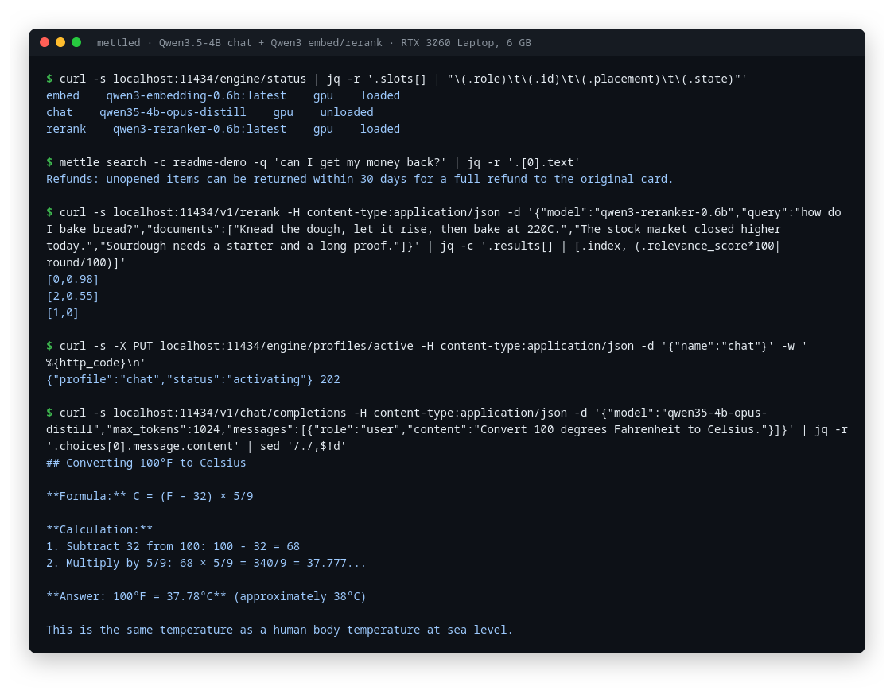
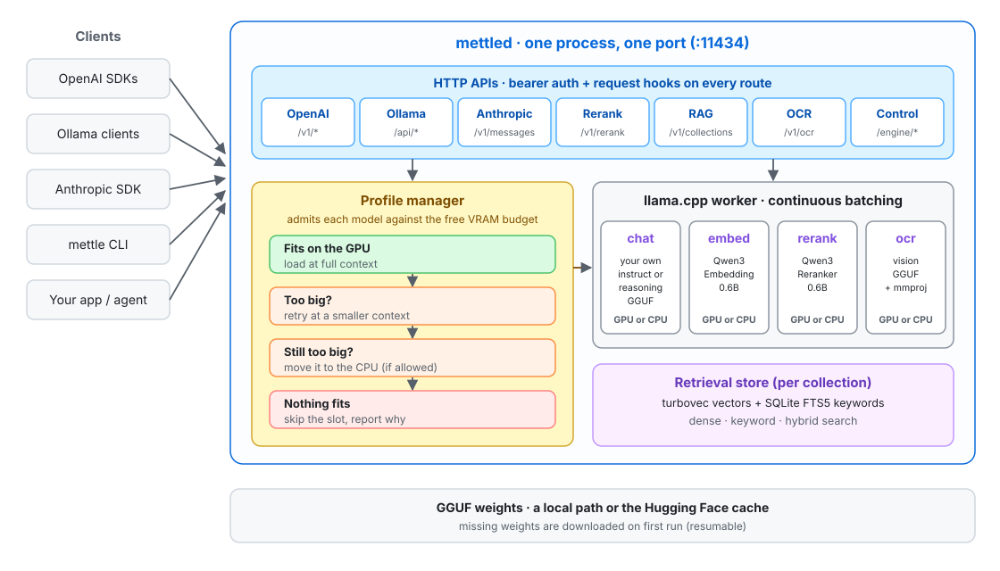

# Mettle

**Run a chat model, an embedder and a reranker side by side on one small GPU.**

Mettle is a local model server written in Rust around llama.cpp. You point it at GGUF models and it serves them over the APIs your tools already speak: OpenAI, Ollama and Anthropic, plus reranking, document search (RAG) and OCR. It all runs in one process on one port.

What makes it different is how it treats GPU memory. Most local servers load a model and then crash with an out-of-memory error when the next one doesn't fit. Mettle checks every model against the free VRAM before loading it. If a model doesn't fit, Mettle gives it a smaller context or moves it to the CPU, and tells you what it did. It was built on, and for, a 6 GB laptop GPU.



## What you get

- **Drop-in APIs.** OpenAI `/v1/chat/completions`, `/v1/embeddings` and `/v1/completions`, Ollama `/api/*`, Anthropic `/v1/messages`, Cohere-style `/v1/rerank`, and `/v1/ocr` for images.
- **Built-in document search.** Create a collection, upload text or PDFs, and search it by meaning, by keyword, or both.
- **Reasoning models handled for you.** The model's thinking goes into `reasoning_content`, so `content` holds only the answer.
- **Profiles.** Group models into named sets, such as "retrieval" and "chat", and switch between them with one request.
- **Downloads its own weights.** On first run, Mettle fetches any missing model from Hugging Face, and the download resumes if interrupted.

## How it works



All models live in one llama.cpp worker as "slots". Before a slot loads, the profile manager compares the model's size against the free VRAM. If it doesn't fit, the manager steps down in a fixed order: a smaller context, then the CPU (for slots marked `placement = "auto"`), and if nothing works, it skips the slot. `GET /engine/status` always shows what is loaded, where, and why anything is missing. `GET /engine/ready` returns 200 only when the active profile is fully serving.

## Install

Linux and macOS (Apple Silicon):

```sh
curl -fsSL https://raw.githubusercontent.com/adityam23/mettle/main/scripts/install.sh | sh
# NVIDIA GPU on Linux:
curl -fsSL https://raw.githubusercontent.com/adityam23/mettle/main/scripts/install.sh | METTLE_VARIANT=cuda sh
```

This installs `mettle` (the CLI) and `mettled` (the server) into `~/.local/bin`. The published binaries are older than `main`, so build from source to get the latest changes:

```sh
cargo build --release                                  # CPU build of mettle + mettled
cargo build --release -p mettle-server --features cuda # NVIDIA build of mettled
```

You need Rust 1.80+, a C/C++ toolchain, and OpenBLAS (`dnf install openblas-devel` or `apt install libopenblas-dev`).

## Quick start

**1. Describe your models** in `~/.config/mettle/config.toml`. Use any instruct GGUF you like for chat. The Qwen3 embedder and reranker are built in and download automatically.

```toml
[[model]]
id = "my-chat"
path = "/models/my-chat-model.Q4_K_M.gguf"
role = "chat"
default = true

[[model]]
id = "qwen3-embedding-0.6b:latest"

[[model]]
id = "qwen3-reranker-0.6b:latest"

[[profile]]
name = "everyday"
default = true

[[profile.slots]]
id = "my-chat"

[[profile.slots]]
id = "qwen3-embedding-0.6b:latest"

[[profile.slots]]
id = "qwen3-reranker-0.6b:latest"
placement = "auto"   # fall back to the CPU if the GPU is full
```

`mettle tune` writes a starting config sized to your GPU, if you'd rather begin from that.

**2. Start the server:**

```sh
mettle serve
```

**3. Talk to it** with any OpenAI client, or with curl:

```sh
curl -s localhost:11434/v1/chat/completions -H content-type:application/json -d '{
  "model": "my-chat",
  "messages": [{"role": "user", "content": "Why is the sky blue?"}]
}'
```

**4. Search your own documents:**

```sh
curl -s -X POST localhost:11434/v1/collections -H content-type:application/json -d '{"name": "notes"}'
mettle ingest -c notes -f handbook.md
mettle search -c notes -q "how do refunds work?"
```

PDFs go through the HTTP API as a file upload: `curl -F file=@handbook.pdf localhost:11434/v1/collections/notes/documents`.

## Good to know

- Reasoning models spend tokens thinking before they answer. If `content` comes back empty with `finish_reason: "length"`, raise `max_tokens`.
- On a 6 GB card, a 4B chat model and a full-context reranker won't both fit on the GPU. Either set `placement = "auto"` on the reranker, or put them in separate profiles and switch with `PUT /engine/profiles/active`.
- Release builds are published for CPU, CUDA (Linux) and Metal (macOS). The Vulkan and ROCm build flags exist but are untested.

## License

GPL-3.0-or-later. See [LICENSE](LICENSE). Mettle embeds llama.cpp (MIT) through [llama-cpp-2](https://crates.io/crates/llama-cpp-2).
